<h1 align="center">@usearazzo/runner</h1>

<p align="center">
  Runner for <a href="https://spec.openapis.org/arazzo/latest.html">Arazzo</a> workflows:
  execute them step by step against the live APIs behind their <a href="https://spec.openapis.org/oas/latest.html">OpenAPI</a> source descriptions.
</p>

<p align="center">
  <a href="https://www.npmjs.com/package/@usearazzo/runner"></a>
  <a href="https://github.com/usearazzo/arazzo-toolkit/blob/main/LICENSE"></a>
  <a href="https://tidelift.com/subscription/pkg/npm-.usearazzo-runner?utm_source=npm-usearazzo-runner&utm_medium=referral&utm_campaign=readme"></a>
</p>

<p align="center">
  <a href="https://usearazzo.com"></a>
</p>

<table>
  <tr>
    <td align="right" valign="middle">
      
    </td>
    <td valign="middle">
      <a href="https://tidelift.com/subscription/pkg/npm-.usearazzo-runner?utm_source=npm-usearazzo-runner&utm_medium=referral&utm_campaign=readme">
        Get professionally supported @usearazzo/runner with Tidelift Subscription.
      </a>
    </td>
  </tr>
</table>

---

## What it does

An Arazzo document describes a multi-step API workflow: which operations to call, in what order, what to pass from one step to the next, and what counts as success. This package runs it.

It loads the workflow and the OpenAPI documents its source descriptions point at. For each step it builds a real HTTP request, sends it to the live API, checks the step's success criteria against the response, and follows the control flow the document declares. When the run ends, you get the workflow's outputs and a trace of every step: whether it passed, which action was picked, how many attempts it took, how long it ran, and the outcome of each criterion it evaluated.

Use it to test an API flow end to end in CI, to drive a workflow from your own service, or to let an agent run a workflow instead of improvising the calls. It handles:

- **Steps.** Parameters and request bodies resolved from runtime expressions, `successCriteria` evaluated (`simple`, `regex`, `jsonpath`, `xpath`), `outputs` resolved from the response.
- **Control flow.** `goto`, `retry` (with `retryLimit`, `retryAfter`, and references), and `end`, as the specification defines them, with workflow-level default actions and parameters, and action `parameters` as the inputs of a `goto` or `retry` workflow target.
- **Composition.** Sub-workflow steps, `dependsOn` prerequisites, one-way transfer to another workflow, and workflows in other Arazzo documents.
- **Observability.** A typed event stream while the run happens: workflows, dependencies, steps, attempts, criterion outcomes and selected actions, plus document loads, normalization, request assembly and every request sent with its response (bodies on request) underneath. Events carry what the run saw, credentials included; a `Redactor` masks them by name before they leave the process. Adapters log them through any logger (`@usearazzo/runner/logging`), stream them (`@usearazzo/runner/stream`), or trace them with OpenTelemetry (`@usearazzo/runner/opentelemetry`), masked by default. Folding a run's workflow events gives back its trace.
- **Your HTTP stack.** Global `fetch` by default, or any client you plug in. Arazzo is auth-agnostic, so credentials come from you: static ones per API, or a request interceptor.

## At a glance

A runner is four building blocks, composed bottom-up; `ArazzoRunner` composes them for you:

| Building block | Job |
|---|---|
| `DocumentRegistry` | Loads and caches the Arazzo document and its OpenAPI source descriptions. |
| `WorkflowExecutor` | Runs a workflow's steps, owns the run state, and acts on the control flow. |
| `StepExecutor` | Runs one step: finds its operation, resolves its inputs, evaluates its criteria and outputs. |
| `OpenAPIOperationExecutor` | Builds one HTTP request, sends it through the `HTTPClient`, and reads the response. |

<p align="center">
  
</p>

### Failed runs and errors

A failed run is a result, not an exception. When a step's criteria go unmet, the run resolves with `status: 'failed'`. A criterion that can't be evaluated, such as an invalid regex, counts as unmet. Each step in `result.steps` lists its criteria and whether each was met ([The result](https://usearazzo.com/docs/runner/#result)).

Only three things throw: a document that can't be loaded or run as written, a request that can't be built or sent, and a cancelled run. Every such error extends `ArazzoRunnerError`, and most carry a `reason` to compare against static fields such as `ExecutionError.WorkflowNotFound` ([Errors](https://usearazzo.com/docs/runner/#errors)).

## Installation

```sh
npm install @usearazzo/runner
```

Ships ESM and CommonJS builds with TypeScript declarations. Requires Node.js 20.10 or newer.

## Usage

The sample workflow logs a user in, finds a pet, orders it, and checks the order. The public Petstore rejects orders, so the session starts a local one for it to call:

<a href="https://usearazzo.com/runner/"></a>

<details>
<summary>Text version</summary>

```console
$ docker run --rm -d -p 8080:8080 swaggerapi/petstore3:1.0.28
e7d2c5a17eb5b5b8c316000c8987d5d4a6c2f93ba161c5bd6fb1cec26cfc9d9a
$ node
Welcome to Node.js v24.10.0.
Type ".help" for more information.
> .editor
// Entering editor mode (Ctrl+D to finish, Ctrl+C to cancel)
const { ArazzoRunner } = await import('@usearazzo/runner');

const runner = await ArazzoRunner.load(
  'https://usearazzo.com/assets/reference/runner/petstore-order.arazzo.yaml',
);
const result = await runner.execute('authenticateAndOrderPet', {
  inputs: { username: 'theUser', password: '12345', preferredPetStatus: 'available', orderQuantity: 1 },
  executeOptions: { petstoreAPI: { server: 'http://localhost:8080/api/v3' } },
});
result.steps.map((s) => `${s.successful ? '✓' : '✗'} ${s.stepId}`);

[
  '✓ loginUser',
  '✓ findAvailablePets',
  '✓ placeOrder',
  '✓ retrieveOrderedPetDetails',
  '✓ verifyOrderConfirmation'
]
> result.status
'completed'
```

</details>

In a script, the same run is a `load` and an `execute`. `ArazzoRunner` wires the four building blocks with their defaults:

```js
import { ArazzoRunner } from '@usearazzo/runner';

const runner = await ArazzoRunner.load(
  'https://usearazzo.com/assets/reference/runner/petstore-order.arazzo.yaml',
);

const result = await runner.execute('authenticateAndOrderPet', {
  inputs: { username: 'theUser', password: '12345', preferredPetStatus: 'available', orderQuantity: 1 },
  executeOptions: { petstoreAPI: { server: 'http://localhost:8080/api/v3' } },
});
```

`executeOptions` is keyed by source description name, so each API gets its own options. Beyond this example:

| To | Use | Reference |
|---|---|---|
| Point an API at another server | `server`, `serverVariables` in its `executeOptions` entry | [Choosing the server](https://usearazzo.com/docs/runner/#server) |
| Send static credentials | `securities` in its `executeOptions` entry | [Authentication](https://usearazzo.com/docs/runner/#authentication) |
| Compute credentials per request | `requestInterceptor` | [Request interceptor](https://usearazzo.com/docs/runner/#request-interceptor) |
| Change the requests of one step, operation or source description only | the `RequestContext` an interceptor receives as its second argument | [Request interceptor](https://usearazzo.com/docs/runner/#request-interceptor) |
| Use another HTTP stack, a proxy or a client certificate for API calls | `httpClient` | [The HTTP client](https://usearazzo.com/docs/runner/#http-client) |
| Load documents behind credentials or mutual TLS | `reference` on `load` | [Document retrieval](https://usearazzo.com/docs/runner/#document-retrieval) |
| Cancel a run | `signal` | [Cancellation](https://usearazzo.com/docs/runner/#cancellation) |
| Watch a run as it happens (progress, logs, debugging) | `observer` | [Observing a run](https://usearazzo.com/docs/runner/#observability) |
| Include request and response bodies in those events | `captureBodies` | [Observing a run](https://usearazzo.com/docs/runner/#observability) |
| Give each `location` (on events, and on the result's steps and criteria) its range in the document, not only its JSON Pointer | `sourceMap` on `load` | [Observing a run](https://usearazzo.com/docs/runner/#observability) |
| Mask credentials before logging or exporting events | `new Redactor().event(event)` | [Observing a run](https://usearazzo.com/docs/runner/#observability) |
| Send the events to several consumers at once | `combineObservers(...observers)` | [Observing a run](https://usearazzo.com/docs/runner/#observability) |
| Observe every runner in the process, and run code around each workflow and step | `instrument({ observer, wrap })` | [Observing a run](https://usearazzo.com/docs/runner/#observability) |
| Log a run through pino, winston, the console or any logger, masked | `loggingObserver(log)` from `@usearazzo/runner/logging` | [Observing a run](https://usearazzo.com/docs/runner/#observability) |
| Read a run's events with `for await`, or pipe them as a `ReadableStream`, masked | `eventStream()` from `@usearazzo/runner/stream` | [Observing a run](https://usearazzo.com/docs/runner/#observability) |
| Trace a run with OpenTelemetry, and propagate the trace into the API calls | `openTelemetryTracing()` from `@usearazzo/runner/opentelemetry` (needs `@opentelemetry/api`) | [Observing a run](https://usearazzo.com/docs/runner/#observability) |
| Compose the building blocks yourself | `DocumentRegistry`, the executors | [Runner API Reference](https://usearazzo.com/docs/runner/) |

Retrieving documents and calling APIs are separate: credentials for one never reach the other.

## Documentation

The example above is the happy path. Everything else is on [usearazzo.com](https://usearazzo.com/):

- **[UseArazzo Runner](https://usearazzo.com/runner/)** introduces the runner: what it handles and how it is built. Start here when you are deciding whether it fits.
- **[Runner API Reference](https://usearazzo.com/docs/runner/)** covers every building block: its options, the result and the step trace, control flow and composition rules, choosing the server, the HTTP client, cancellation, and every error. Start here when you know what you want to call.

## Supported versions

Arazzo documents:

- [Arazzo 1.0.0](https://spec.openapis.org/arazzo/v1.0.0)
- [Arazzo 1.0.1](https://spec.openapis.org/arazzo/v1.0.1)
- [Arazzo 1.1.0](https://spec.openapis.org/arazzo/v1.1.0)

OpenAPI documents, as source descriptions:

- [OpenAPI 2.0](https://spec.openapis.org/oas/v2.0)
- [OpenAPI 3.0.x](https://spec.openapis.org/oas/v3.0.4)
- [OpenAPI 3.1.x](https://spec.openapis.org/oas/v3.1.2)

## Part of the Arazzo Toolkit

`@usearazzo/runner` is the execution layer of the [arazzo-toolkit](https://github.com/usearazzo/arazzo-toolkit) monorepo, beside [@usearazzo/parser](https://github.com/usearazzo/arazzo-toolkit/tree/main/packages/parser#readme), [@usearazzo/resolver](https://github.com/usearazzo/arazzo-toolkit/tree/main/packages/resolver#readme), [@usearazzo/validator](https://github.com/usearazzo/arazzo-toolkit/tree/main/packages/validator#readme), and [@usearazzo/cli](https://github.com/usearazzo/arazzo-toolkit/tree/main/packages/cli#readme). Questions and ideas go to [GitHub Discussions](https://github.com/orgs/usearazzo/discussions).
